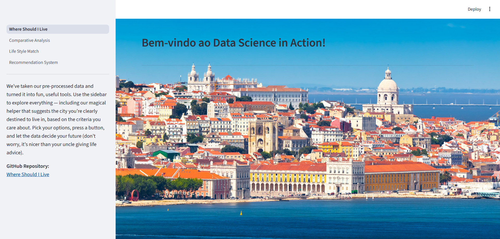
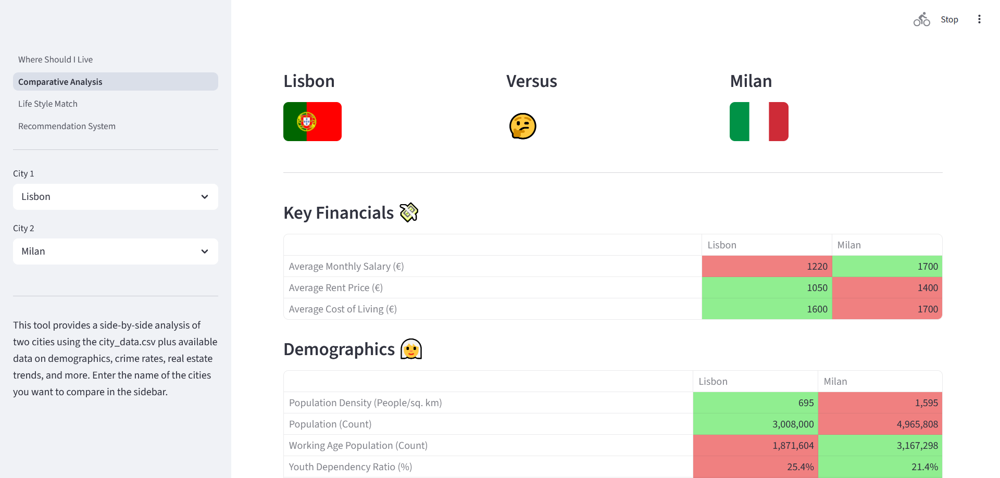
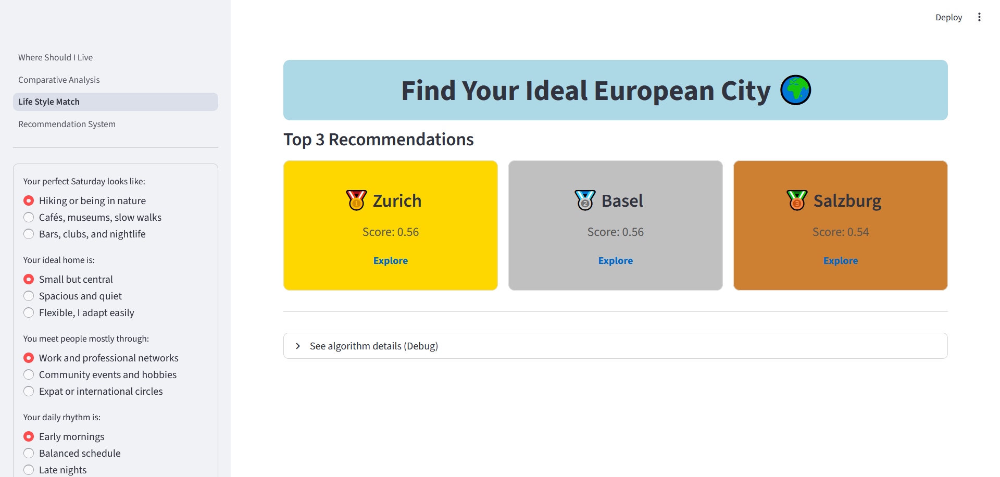
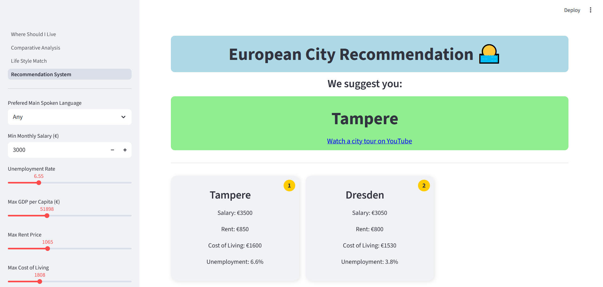

# Where Should I Live?

A Streamlit application that helps users explore European cities based on lifestyle preferences, using city recommendations, lifestyle matching, and comparative analysis.

**Course:** Programming for Data Science (2025/2026)  
**Institution:** NOVA Information Management School (NOVA IMS), Lisbon, Portugal  

## Project structure

```text
├── requirements.txt
├── Group22_PDS_2526.ipynb
└── data-science-in-action/
    ├── components/
    ├── images/
    └── pages/
        ├── Comparative Analysis.py
        ├── Life Style Match.py
        ├── Recommendation System.py
        └── Where Should I Live.py
```

## Setup

1. Create and activate a virtual environment (recommended):

   ```bash
   python -m venv venv
   # macOS / Linux
   source venv/bin/activate
   # Windows (PowerShell)
   .\venv\Scripts\Activate.ps1
   ```

2. Install dependencies:

   ```bash
   pip install -r requirements.txt
   ```

3. Start the Streamlit app from the repository root:

   ```bash
   streamlit run "data-science-in-action/Where Should I Live.py"
   ```

## Application previews

**Welcome page**  


**Compare two European cities**  


**Lifestyle matching**  


**City recommendations**  


## Attribution

- A. K. M. Saif Hoque
- Daniyal Ahmad
- Ali Fardin Gulistani
- Atila Soleimanian: developed the entire Streamlit application, contributed to the data analysis notebook, and reviewed team members' work to ensure code quality and consistency.
